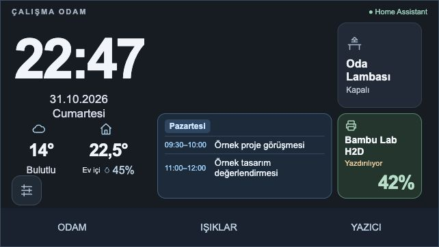
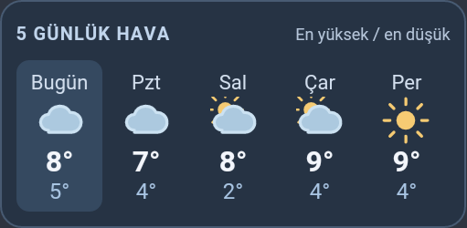
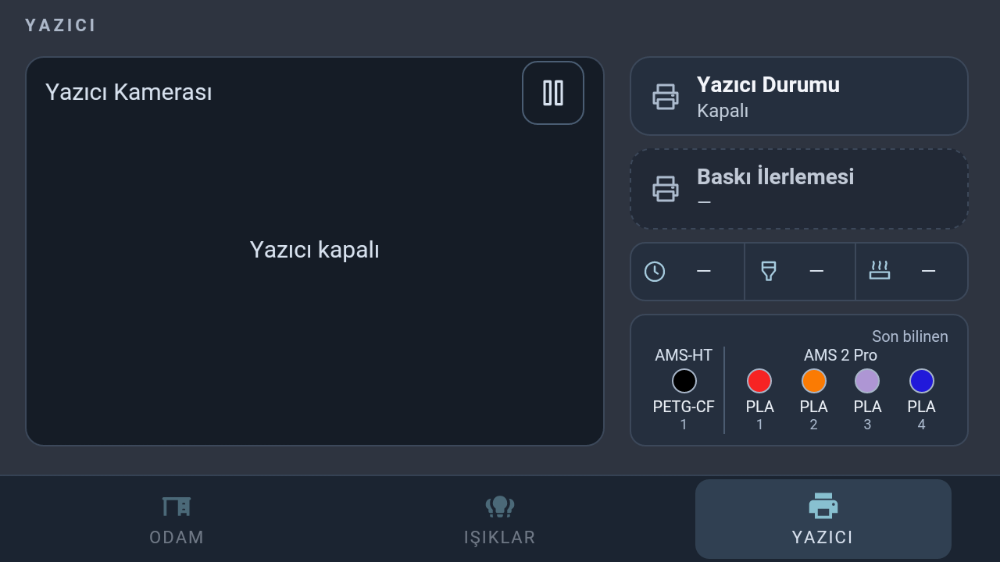

# Office dashboard profile (Samsung test device)

This optional landscape profile is independent of the default Denver dashboard.
Install it as a separate HoaryDash dashboard route with `profile: "office"` in
its private mapping. Do not replace an existing household dashboard to enable it.

The home view prioritizes the office lamp and a printer summary. Iris is available
under Işıklar → Odalar. Room-off remains in Işıklar → Toplu; it is not a home tile.
Robot and native battery controls can be omitted for a batteryless office panel.

## Printer power

An existing power switch can be assigned explicitly:

```json
"printer": {
  "label": "3D Yazıcı",
  "status": "sensor.example_print_status",
  "progress": "sensor.example_print_progress",
  "remaining": "sensor.example_print_remaining",
  "power": "switch.example_printer_power",
  "camera": "camera.example_printer"
}
```

Use the actual switch from the existing power automation, not a chamber-light,
fan, or camera entity. There is no separate home power button. One tap on the
home printer summary opens Yazıcı; two taps within350ms control its power. The
printer status card on Yazıcı also accepts the same double tap.

With a confirmed off switch state, double tap turns power on directly. With an
on switch state, it opens a separate confirmation with Vazgeç and Gücü Kapat.
If the printer is printing, preparing, slicing, or paused, a checkbox must be
selected before power-off is enabled. The job requirement is reevaluated while
the dialog is open and again before sending a command, including a job that
starts after the dialog was opened. Idle/finished printers do not show the box.
The confirmation also rechecks switch availability and state. Opening or
cancelling it never sends a power command. Device power is excluded from
household all-lights-off targets.

## Native navigation control

In the Samsung app, Panel Settings → Alt Tuşlar opens the native navigation-lock
settings. This requires the Samsung flavor's optional Accessibility service.
Home, Back and Recent Apps can be blocked while the dashboard is foregrounded;
Power and volume remain normal. Serbest restores navigation. No Accessibility
service is added to the Denver flavor. In a regular web browser the native
control is unavailable; this link is intended for the Samsung panel app.

This profile is experimental. Compilation and mock tests do not replace the
installed-device checks in regression-checklist.md. Physical screen and wake
acceptance is recorded separately; full panel blanking is not yet accepted.

## Printer camera view

The visible Yazıcı tab retains the internal Diğer route for existing bookmarks.
It removes the clock/date/weather column and uses the full body for camera plus
print metrics. Snapshots are requested through the existing authenticated server
proxy; no access token or printer password is embedded in the dashboard. A frame
is requested two seconds after the previous frame loads. Errors retry after ten
seconds. Leaving the tab, hiding the page, or pressing Duraklat cancels refresh
and removes the displayed frame. Unavailable camera states show an explicit
message and do not start image requests.

The Home Assistant camera entity must work first. H2D/H2S owners must enable
LAN Only Liveview in the printer's network settings, as documented by the
[integration setup guide](https://docs.page/greghesp/ha-bambulab/setup). This is
separate from switching the entire printer to LAN-only operation. A camera tile
or successful mock test does not establish working live video on the device.

## Startup and compact printer details

A power-on request enters a temporary Açılıyor state. It is ended by a fresh
Home Assistant status report, not an old cached idle snapshot, and expires after
two minutes. After readiness, ordinary printer state controls the display again.
Switch state is read before each double tap and read back after a power command.
An off switch is Kapalı; an on switch with an unreachable printer is Çevrimdışı.
Camera requests are suppressed when the switch is not on or the printer is offline.

Optional printer mapping fields `nozzle` and `bed` are temperature sensor entities.
`filaments` is an array of `{ "entity": "sensor.example_tray_1", "label": "A1" }`.
With these fields the right column shows status, progress as a soft green card
fill, a compact time/nozzle/bed row, and filament material/color chips. Active
trays are marked. Disconnected data is labelled Son bilinen; unavailable telemetry
uses a dash rather than stale temperatures. RFID, spool identifiers and print
filenames are not displayed or exported.

## Indoor temperature and physical AMS order

Both profiles can optionally set `indoorTemperature` to a temperature sensor and
`indoorLabel` to a descriptive label. A house icon and a large one-decimal reading share the weather area below the
clock, beside the outdoor value. Controls and the clock retain their positions.
Missing/disconnected values show a dash; weather and indoor values remain distinct.
The installer subscribes to the configured sensor without creating HA entities.

Filament entries can optionally include a `group` label. Their configuration
order defines the physical display order, e.g. AMS-HT with slot label1 first,
then AMS2Pro with labels1–4. Each group has its own heading and divider. These
labels are presentation-only; power automation and HA entity identity do not change.
Camera pause/play buttons use SVG icons with descriptive accessible labels.

## Spacing conventions

Cards use8px vertical and12px horizontal padding with a fixed icon slot and
consistent title/value rhythm. Compact printer cards retain their own smaller
font scale. Telemetry and filament panels follow the same insets; repeated office
style overrides have been consolidated into one component rule per variant.
The lower-left settings control is offset10px downward on both profiles, retaining
clearance from the bottom navigation. Its hit target size is unchanged.

Optional `indoorHumidity` accepts the matching HA humidity sensor entity. Its
percentage appears with a droplet beside the indoor caption, using the existing
weather row on both profiles. Values outside0–100 or unavailable/disconnected
states display a dash. Samsung uses26px temperature numerals and16px humidity;
Denver retains44px temperature numerals with18px humidity. The shared reading
area is offset6px left without moving the clock or control grid. The extra sensor
uses the existing state subscription, not a new periodic polling loop.

## Optional workday agenda

Set an explicit `agenda` sensor ID in the private office mapping to enable the
six-cell home layout. The office lamp and printer remain in the right column.
The agenda occupies the lower-left two cells, leaving the upper-left pair
available for later information. Without `agenda`, the previous home layout is
preserved. Denver must not receive this setting or subscribe to meeting titles.

The sensor comes from Mac Call Indicator's optional macOS Calendar channel:
[Calendar setup and freshness (companion draft)](https://github.com/kilinccagatay/mac-call-indicator/pull/1).
It provides `events` (title/start/end), `day_start`, and `valid_until` attributes.
The compact view shows two remaining meetings, or three when height permits.
Past events disappear; an empty fresh day says no meetings remain. An expired
lease, unavailable sensor or disconnected socket says the calendar cannot be
updated, rather than displaying a misleading empty schedule. Weekends use the
next Monday selected by the Mac helper. Calendar titles render as text only.

EventKit change notifications plus a one-minute query fallback detect changes
once they have synced into macOS Calendar. Heartbeats expire after 90 seconds.
Neither this display nor a weekday schedule can guarantee invitation delivery
while the Mac is asleep or the calendar provider has not synchronized.

Tests use synthetic titles. Never commit a private mapping, calendar payload,
webhook credential or a screenshot containing real work meetings.

After adding a newly subscribed entity, restart HoaryDash once: its existing
WebSocket handlers can retain the previous entity list even after the HTML is
rebuilt. Asset-only edits with the same subscriptions do not require this. Verify
actual incoming events and reconnection, rather than treating HTML refresh as
proof that a new subscription is active.

The home printer summary uses subdued accents for ready, printing, preparation,
pause, error and completed states. While a live job has a valid progress value,
the percentage appears in the lower-right corner. Power-off, unavailable and
invalid values hide it even if an old printer status still says running. Existing
single-tap navigation and double-tap power confirmation are preserved.



The illustration uses synthetic meeting titles and a simulated print percentage;
it contains no actual calendar content and is not a physical printer test.

Printer telemetry uses fixed-size centered icon boxes and equal-width cells.
Remaining time is shown only for an active job; idle state shows an em dash
while nozzle and bed readings remain live. An active job estimated below one
minute shows `<1 dk` rather than claiming a completed print.

Configured AMS slots always retain their physical positions and numbers. Empty
or unavailable slots show an em dash material label and a gray/white checker
swatch; an empty slot cannot retain the active-filament highlight.

## Daily weather overview

Set `weeklyForecast: true` in the private office mapping to fill the upper-left
pair above the agenda. Set `forecastDays: 5` for five wider columns (default: seven). The first column is always today, followed by consecutive local calendar days. This option requires the office agenda layout; Denver
remains unchanged. The widget reads daily forecasts from the existing Home
Assistant weather entity through HoaryDash's authenticated proxy. No location,
weather API key or Home Assistant token is placed in frontend configuration.

The read-only card shows Turkish weekday labels, distinct colored SVG weather
symbols and daily high/low temperatures. It requests forecasts at most every
30 minutes while the home view is visible, retries failures after one minute,
and expires cached values after one hour. Disconnection hides cached values.
A provider may supply fewer than seven days: those days retain their columns
with em dashes and an explicit missing-data note, rather than invented readings.
No native selection menu or service command is triggered by holding the card.

Actual Samsung forecast card (cropped to exclude calendar titles and private configuration):



## Power-off and retained printer readings

The configured printer power switch takes priority over cached print sensors.
While a power-off command is awaiting confirmation the UI shows `Kapatılıyor…`
and suppresses progress and live telemetry. Confirmed power-off shows `Kapalı`;
progress/remaining time/temperatures become em dashes, progress fills clear and
camera requests stop. A retained `running` state or percentage cannot keep the
home percentage visible without confirmed power. A bounded shutdown state clears
on failure or timeout; startup continues to wait for a fresh printer response.
Filament metadata can remain labelled `Son bilinen`, but no slot is marked active
while the printer is off, starting, shutting down or disconnected.

Actual Samsung Printer view with the configured power switch off:


