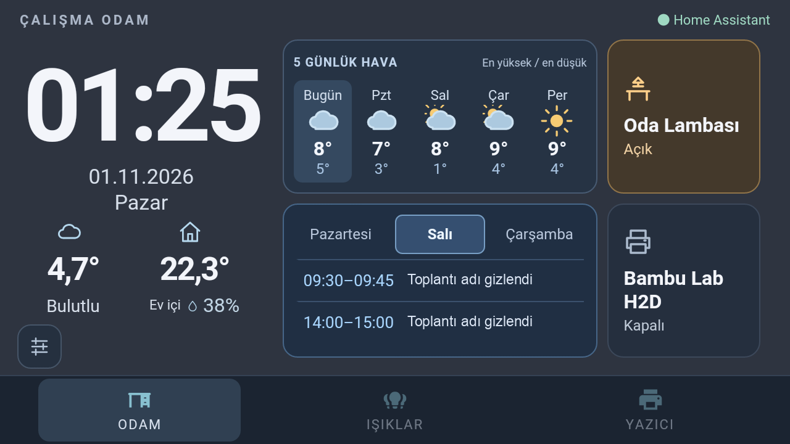
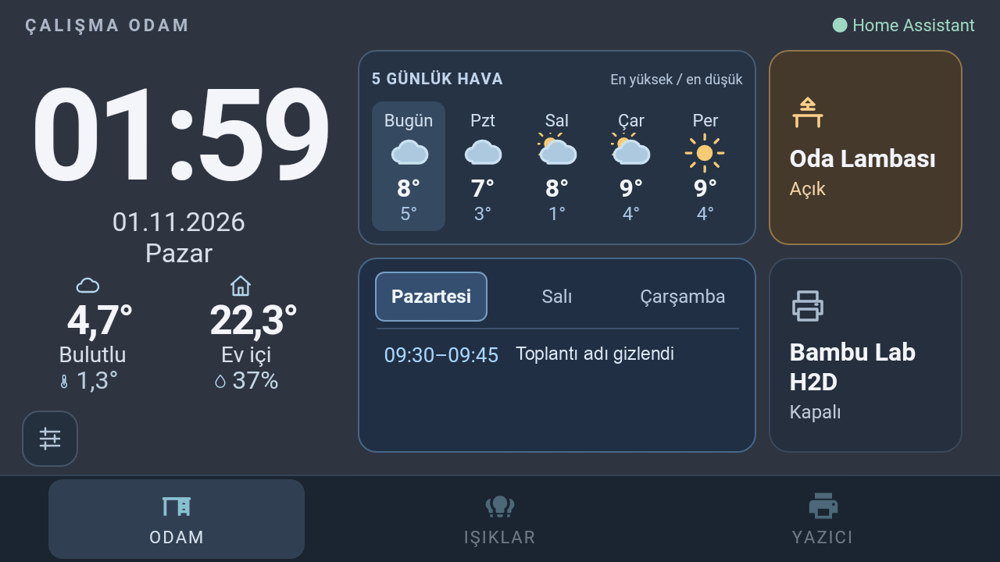
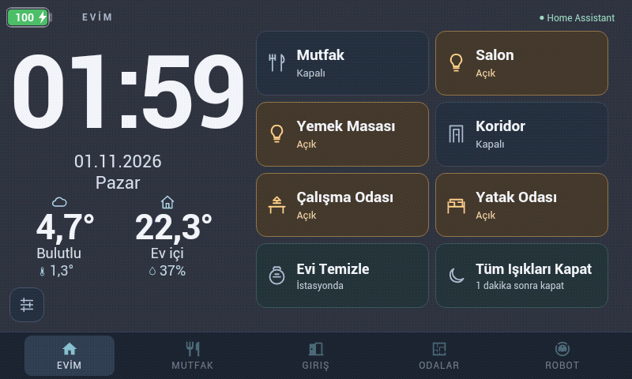

# Three-workday agenda — scoped validation, 2026-11-01

**Overall: NOT ACCEPTED as a complete device revision.** The calendar UI/data path
works, but the complete physical-device regression below remains PENDING. This
record includes the whole mandatory gate; no desktop preview is called hardware
acceptance.

## Installed scope and rollback

- MacCallIndicator 0.4.0 development Build 8: three-workday EventKit query and
  title/time-only report. Calendar change notifications, one-minute fallback,
  90-second lease and independent boolean meeting channel are preserved.
- Updated HA agenda validator/sensor accepts both legacy one-day and bounded
  three-day reports. Title arrays `events` and `days` are unrecorded attributes.
- Samsung native Build 13: one display-dark notification after brightness zero
  and actual Android screen-off; no brightness/motion/power policy change.
- Office web assets only: three equal selected-day tabs, actual-day filtering,
  selection retained on heartbeat and reset on `panel-display-dark`/document hide.
- Calendar changes do not add titles to Denver. A follow-on apparent-temperature
  update changes shared web assets on both profiles; Denver APK remains unchanged.
- Previous Mac app, Samsung APK/preferences, HA integration and office assets
  were backed up privately. Restore matching previous files and refresh the
  office URL; restore the previous app/APK without clearing settings if needed.
- Samsung backlight-only helper: existing `91-samsung-office-display.sh`,
  SHA-256 `1cc58eda0d2d5b8b66b49f661c4ce06a450438bf41bbad87e83049ad24b06393`.
  Its file was not edited. Denver helper identity was not revalidated.
- Existing unrelated Android working-tree changes were preserved. Publication
  selects only the new event hook and its guide from that tree.

## Results

The live receiver showed three independent day lists with 1, 2 and 2 events.
Actual Samsung Tuesday selection showed Tuesday's two events; ordinary refresh
kept the selection. The user reported Calendar permission had been lost after
reinstallation and confirmed that regranting it restored the calendar. Existing
Accessibility authorization was true after installation; never assume Calendar
permission survived just because Accessibility did.

Native logs show brightness-dim notifications exactly 30 seconds after the last
motion in two captured intervals. The UI returned to the first tab after that
notification. The user nevertheless reported the light did not switch off:
the Samsung backlight driver helper was not running before this update. During
a bounded 90-second helper test, the user confirmed the display darkened and the
calendar returned to Monday. The existing boot-profile helper was then restarted
without editing it. One live PID and its command line were checked; no temporary
helper was left running. This single-cycle observation does not prove the full
three-cycle/dim-room/reboot/overnight gate.

Only work titles were replaced with flat neutral labels; times and layout are real.
The public image contains no underlying work-title pixels or original metadata.

Samsung `Start on boot` is enabled, BOOT_COMPLETED is granted, and the installed
receiver starts the welcome/dashboard activity. Actual reboot persistence remains
PENDING; configuration inspection is not a reboot test.

## Complete gate

| ID | Denver | Samsung | Evidence / outstanding work |
| --- | --- | --- | --- |
| D01 | PENDING | PENDING | No cold boot performed; batteryless Samsung must not be rebooted casually. |
| D02 | PENDING | PASS | Samsung native dim occurs 30 seconds after last motion; user confirmed dark and first-day reset after the helper test. Denver physical timeout not repeated. |
| D03 | PENDING | PENDING | Samsung single dark/reset cycle confirmed; normal existing helper restarted. Complete stable/no-flicker observation on final installed state remains pending. |
| D04 | PENDING | PENDING | Three physical wake cycles and dim-room observation outstanding. |
| D05 | PENDING | PENDING | Two-minute dark-scene and false-wake test outstanding. |
| D06 | PENDING | PENDING | Physical power-key sequence not repeated. |
| D07 | PENDING | PENDING | Original long-power menu not repeated. |
| D08 | PENDING | PENDING | Settings/navigation taps worked; full idle/lamp-action sequence not repeated. |
| D09 | PENDING | N/A | Denver badge visible; physical long-press/12-second hide not repeated. Samsung has no battery overlay. |
| D10 | PASS | N/A | Denver APK/assets unchanged; previous native overlay evidence remains applicable. Office has no battery badge. |
| D11 | PENDING | PENDING | No root-helper stop/recovery or duplicate-process test. |
| D12 | PENDING | PENDING | Wi-Fi ADB reachable; reboot persistence not retested. |
| D13 | PENDING | PENDING | No new uninterrupted 30-minute/overnight acceptance run; final Samsung hold survived. |
| D14 | N/A | PASS | Samsung Build 13 retained all user preference values; only launch URL version and internal Chromium resource version changed. Denver APK unchanged. |
| U01 | PASS | N/A | Denver remains byte-identical to its prior deployed web version. |
| U02 | PASS | PASS | Native office captures show Turkish clock/date/weather and live indoor readings; Denver unchanged. |
| U03 | PASS | PASS | Actual Samsung Home shows three fitting day tabs and two meeting rows. Denver unchanged. |
| U04 | PENDING | PENDING | Tab layout reviewed, but full reload/wake/idle-return sequence not observed end-to-end. |
| U05 | PENDING | PENDING | Sound state toggles/persists and geometry is stable. Physical audibility and once-on-finger-down need user confirmation. |
| U06 | PENDING | PENDING | Denver user confirmed open/close; Samsung final hold passed. Full timing/drag/cancel matrix remains physical PENDING; automated gesture tests pass. |
| U07 | PENDING | PENDING | X closes dimmer/settings and focus guards pass. Physical close-feedback audibility not verified. |
| U08 | PASS | PASS | Equal day widths, symmetric 4px/3px padding, 8px gaps, selected/unselected insets reviewed in browser and native capture; Denver unchanged. |
| H01 | PASS | N/A | Denver reference order retained; Samsung office order intentionally differs. |
| H02 | PENDING | N/A | Automated groups pass; household actuation not performed. Office does not expose these Home groups. |
| H03 | PENDING | PENDING | Final Samsung dialog sends no lamp state change; complete toggle matrix not actuated. |
| H04 | PENDING | PENDING | DOM live-state/drag tests pass; physical supported-color/brightness actions not repeated. |
| H05 | PENDING | PENDING | DOM preset success/failure/tint tests pass; physical color changes not performed. |
| H06 | PENDING | PENDING | Default-tone command regression passes; physical tone checks not repeated. |
| H07 | PENDING | N/A | Robot logic tests pass; no cleaning actuation. Robot absent from office profile. |
| H08 | PENDING | N/A | Countdown state tests pass; no household shutoff run. Countdown absent from office Home. |
| H09 | PENDING | PENDING | Live optional agenda has three days (1/2/2 events) and valid heartbeat; native Tuesday selection shows its two meetings. User renewed Calendar permission after the new build. Physical dark/reset/wake and full meeting-source matrix remain pending. |
| H10 | PENDING | PENDING | Automated offline/reconnect tests pass; live HA network outage not induced. |
| H11 | N/A | PENDING | Printer off rendering inspected and office regression passes; full physical acknowledgement/startup/failure matrix not repeated. |
| E01 | PASS | PASS | 20 Swift tests, 15 HA tests, panel suites, five installer tests, ES5 parse and Samsung flavor build passed. |
| E02 | PASS | PASS | Office source matches served HTML; Samsung package reports Build 13 and Mac app Build 8. Denver assets/APK not updated. |
| E03 | PASS | PASS | Actual Home screenshot has flat title redactions; private mappings/credentials/raw captures excluded. |
| E04 | PASS | PASS | Intended code, safe screenshots and guides published to the development branches. Complete runtime acceptance remains blocked by PENDING rows. |

## Automated verification

- `swift test`: 20 tests passed, including three workdays, weekend skipping,
  independent future-day events, bounded privacy fields and meeting precedence.
- `.local/ha-test-env/bin/python -m pytest tests_ha -q`: 15 passed, including
  optional-day schema, malformed/cross-day payload rejection and legacy clients.
- `sh scripts/build-app.sh`: successful development Mac build.
- `JAVA_HOME=<local JDK 8> ANDROID_HOME=<local SDK> sh gradlew assembleProdSamsungDebug --offline`:
  successful native Samsung build; installed with settings-preserving replacement.
- Panel `agenda-panel`, `office-panel`, `forecast-panel`, `panel-ui`, `panel-v2`
  suites passed; the installer Python suite passed all five tests.
- Agenda tests cover selection, independent day contents, heartbeat preservation,
  display-dark reset, empty days, expired/offline state and native-selection guards.
- Shared panel JavaScript parsed as ES5; diff/link checks passed.

Browser tabs measure approximately 72.49 × 32 CSS px each in the 640 × 360
reference frame (actual Samsung screenshot is 1280 × 720). All use equal insets
and an 8 px inter-tab gap. No household device was actuated.

## Follow-on weather alignment

Open-Meteo apparent-temperature sensor was added to HA and both panel profiles;
see [the source/setup guide](outdoor-feels-like.md). Both columns now have three
matching rows. The apparent temperature/humidity use 18 px on Denver and 16 px
on Samsung. Units are positioned outside numeric layout width: browser center
offsets were less than 0.01 px in both profiles, and caption/secondary row tops
matched exactly. Main temperature fonts remain unchanged. Samsung clock/date
leading frees six pixels for larger secondary readings; Denver settings shifts
eight pixels down while preserving navigation clearance.

Actual final screenshots were checked for overlay/row/caption collisions.
Negative/zero/positive values, stale/unavailable samples and regional coordinate
rounding passed both DOM and real HA-template tests (`tests/weather-rest.test.py`).
Leading icons and suffix units are outside numeric layout width; main and
secondary numbers both measured less than 0.01 px from their column centers. Source identity is verified
for both served profiles. These checks do not replace pending power/camera checks.

## Deployed shared source SHA-256

- `panel.js`: `eb811ab73eed3ec6f0be037c54ef00383e5896b4a430595ec3b3fbbc4d578022`
- `panel.css`: `038545ae3d58d9b4cfbffc275ac8a18013ec53de26d60be6456fc7c2ef7555b2`
- `office.css`: `1300c2dd72d1b1a9373b389aaeb65c77fa06a295ff50003af2c5e03f95d8218f`
