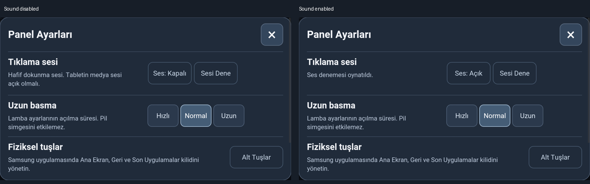
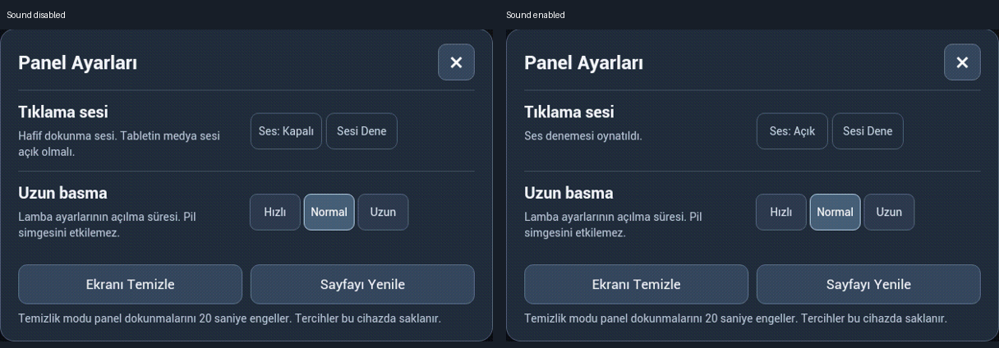
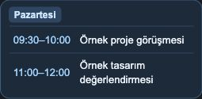

# UI alignment and settings stability review — 2026-11-01

This is a scoped review, **not full device acceptance**. The installed web assets
were compared byte-for-byte with the source for both profiles. Samsung remains
on native Build 12 and Denver on Build 8; no APK, firmware, camera, power or root
helper changes were made. Private mappings, screen lists and preferences were
preserved. Sound was toggled off/on for testing and restored to enabled.

## Changes and evidence

- Agenda time and title use the same 13 px / 18 px line box. Rows reserve the
  selected border and center both one-line and wrapped titles. A synthetic
  640 × 360 browser fixture measured zero vertical-center difference for both.
- Shared settings rows have balanced vertical padding, a centered X and a block
  settings SVG. Existing touch-target sizes are preserved.
- Audio success no longer adds an extra paragraph. Test/error feedback reuses a
  fixed-height description inside the audio row. Ordinary click feedback does
  not replace that description. The setting still persists separately per profile.
- A touch beginning a custom long-press card cancels native text selection.
  Before this guard, Samsung crashed in Crosswalk's native context-menu path
  (`libxwalkcore.so`, SIGSEGV). Three controlled holds passed after the guard;
  another hold passed on the final audio revision, opening and closing the
  actual dimmer without changing the lamp state or its change timestamp.
- Denver lamp-dialog opening/closing was confirmed by the user. Automated
  duration-based swipe is not treated as a reliable hold test on Android 4.1.

### Actual installed settings: disabled versus enabled

These are cropped physical-device captures. They show the same dialog boundaries,
row dividers and control positions on both sides; only the label/feedback changes.
No calendar titles or private configuration are included.





Browser geometry before / sound off / sound on / explicit test:

| Viewport | Dialog top | Height | Scroll content height | Scroll position |
| --- | --- | --- | --- | --- |
| Samsung layout, 640 × 360 | 10.797 px | 338.398 px | 436 px | 0 px |
| Denver, 800 × 480 | 45.5 px | 389 px | 387 px | 0 px |

All four states had identical measurements. Denver Fast/Normal changes also
retained all measurements. In the shorter Samsung viewport, scrolling to the
below-fold timing control changed scroll position to 35.5 px as expected; the
window size and content height stayed fixed. This is intentional focus scrolling,
not a settings-induced resize.



The agenda illustration uses generic fixture titles; it is not a real work calendar.
Native tabs were also visually inspected: Denver Home/Kitchen/Entrance/Rooms/Robot;
Samsung Home/Lights/Kitchen/Entrance/Bulk/Printer. No household power, color,
brightness or cleaning action was invoked for this visual review.

## Complete gate record

Statuses below apply to this installed review. Earlier confirmations are not a
substitute for repeating physical checks. PENDING and FAIL prevent declaring the
whole revision accepted. Root-helper processes/display profiles were not modified;
their full identity and restart supervision must be revalidated with the device checks.
Rollback: timestamped `before-visual-alignment-*` backups hold the previous
configuration and each replaced asset. Restore the matching profile assets and
configuration together, then refresh only that profile; keep private mappings.

| ID | Denver | Samsung | Evidence / outstanding work |
| --- | --- | --- | --- |
| D01 | PENDING | PENDING | No cold boot performed; batteryless Samsung must not be rebooted casually. |
| D02 | PENDING | PENDING | No new physical covered-camera timeout test. |
| D03 | PENDING | FAIL | Samsung display/helper baseline remains unresolved; this UI change does not repair it. Denver physical dark-state test not repeated. |
| D04 | PENDING | PENDING | Three physical wake cycles and dim-room observation outstanding. |
| D05 | PENDING | PENDING | Two-minute dark-scene and false-wake test outstanding. |
| D06 | PENDING | PENDING | Physical power-key sequence not repeated. |
| D07 | PENDING | PENDING | Original long-power menu not repeated. |
| D08 | PENDING | PENDING | Settings/navigation taps worked; full idle/lamp-action sequence not repeated. |
| D09 | PENDING | N/A | Denver badge visible; physical long-press/12-second hide not repeated. Samsung has no battery overlay. |
| D10 | PASS | N/A | Denver native captures on all tabs retain badge clearance; Samsung has no overlay. |
| D11 | PENDING | PENDING | No root-helper stop/recovery or duplicate-process test. |
| D12 | PENDING | PENDING | Wi-Fi ADB reachable; reboot persistence not retested. |
| D13 | PENDING | PENDING | No new uninterrupted 30-minute/overnight acceptance run; final Samsung hold survived. |
| D14 | N/A | N/A | No app update. Web refresh retained APK and existing preferences. |
| U01 | PASS | N/A | Denver native tab captures show logical shared layout; Samsung intentionally uses office navigation. |
| U02 | PASS | PASS | Native screenshots show Turkish two-line date and live weather/indoor data. |
| U03 | PASS | PASS | Native tab/settings/dimmer captures reviewed for clipping, overlays and icon visibility. |
| U04 | PENDING | PENDING | Tab layout reviewed, but full reload/wake/idle-return sequence not observed end-to-end. |
| U05 | PENDING | PENDING | Sound state toggles/persists and geometry is stable. Physical audibility and once-on-finger-down need user confirmation. |
| U06 | PENDING | PENDING | Denver user confirmed open/close; Samsung final hold passed. Full timing/drag/cancel matrix remains physical PENDING; automated gesture tests pass. |
| U07 | PENDING | PENDING | X closes dimmer/settings and focus guards pass. Physical close-feedback audibility not verified. |
| U08 | PASS | PASS | Installed off/on settings captures, native tab review, equal row padding and browser geometry evidence above. |
| H01 | PASS | N/A | Denver reference order retained; Samsung office order intentionally differs. |
| H02 | PENDING | N/A | Automated groups pass; household actuation not performed. Office does not expose these Home groups. |
| H03 | PENDING | PENDING | Final Samsung dialog sends no lamp state change; complete toggle matrix not actuated. |
| H04 | PENDING | PENDING | DOM live-state/drag tests pass; physical supported-color/brightness actions not repeated. |
| H05 | PENDING | PENDING | DOM preset success/failure/tint tests pass; physical color changes not performed. |
| H06 | PENDING | PENDING | Default-tone command regression passes; physical tone checks not repeated. |
| H07 | PENDING | N/A | Robot logic tests pass; no cleaning actuation. Robot absent from office profile. |
| H08 | PENDING | N/A | Countdown state tests pass; no household shutoff run. Countdown absent from office Home. |
| H09 | PENDING | PENDING | Agenda expiry/empty-state tests pass and real office agenda renders. Live meeting/heartbeat/sync scenarios not repeated. |
| H10 | PENDING | PENDING | Automated offline/reconnect tests pass; live HA network outage not induced. |
| H11 | N/A | PENDING | Printer off rendering inspected and office regression passes; full physical acknowledgement/startup/failure matrix not repeated. |
| E01 | PASS | PASS | Relevant automated checks and ES5 parses passed; see commands below. |
| E02 | PASS | PASS | Final embedded asset bytes match source; native captures taken after per-profile refresh. |
| E03 | PASS | PASS | Only intended source/tests/docs and safe cropped or synthetic images selected; private data excluded. |
| E04 | PASS | PASS | Intended source, tests and this evidence guide published on the development branch; full runtime acceptance remains blocked by rows above. |

## Automated checks

All passed:

```sh
NODE_PATH=/tmp/denver-panel-ui-tests/node_modules node tests/panel-ui.test.cjs
node tests/panel-v2.test.cjs
NODE_PATH=/tmp/denver-panel-ui-tests/node_modules node tests/office-panel.test.cjs
NODE_PATH=/tmp/denver-panel-ui-tests/node_modules node tests/agenda-panel.test.cjs
NODE_PATH=/tmp/denver-panel-ui-tests/node_modules node tests/forecast-panel.test.cjs
python tests/panel-install.test.py
npx --yes --package acorn acorn --ecma5 examples/panel-v2/core.js
npx --yes --package acorn acorn --ecma5 examples/panel-v2/panel.js
git diff --check
```

The Python installer suite ran in the existing isolated HA test environment
(five tests). DOM regression now verifies that normal audio does not replace the
description, explicit tests reuse that description, and toggling sound inserts
no additional row. Gesture regression asserts native selection is cancelled
while preserving custom long-press/tap separation.

### Deployed source SHA-256

- `core.js`: `9a3ce7440c00bbd70d14671a1807c143ba369b20ddb8c08286ddde769b38059d`
- `panel.js`: `af82b616b221c5d75c589ec87b3053d18080043eeef45606a76e48b42c3c2bd9`
- `panel.css`: `0ed8685a0e67fb444bb5179c90301579e8b7f4b01cb26e3682dd13ff514de762`
- `office.css`: `8fb0bf3ec0055608f4c7bd83d387f2728c931444b333cf99b45a0698ce804a2f`
